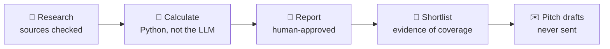

<div align="center">

# Research to Outreach

**From a topic to a checked report, then to a shortlist of journalists and unsent pitch drafts.**

You choose the question, check the sources and approve every story and pitch. Python does the maths and checks the files.
An LLM helps research and write, but never invents numbers, evidence or contacts.


<br>


<sub>From the worked example: an invented, deliberately narrow calculation, not real savings.</sub>

</div>

<br>

## What you get



| | File | What it is |
|:-:|---|---|
| 📝 | `report.md` | Question, sourced findings, calculation and assumptions, limitations, source URLs |
| 📚 | `sources.md` | Every claim with title, publisher, URL, access date and what it actually supports |
| 👥 | `shortlist.json` | Journalists who *actually covered* the topic, with the article that proves it |
| ✉️ | `pitches.md` | One short, tailored, **unsent** pitch per credible candidate |

> [!IMPORTANT]
> This is **not** one command that turns any topic into a trustworthy report and a list of journalists.
> If sources or data are missing, you get a partial package with the gaps named, not a made-up result.

<br>

## Before you start

- [ ] **A coding LLM that can read files and run Python**: [Claude Code](https://claude.ai/download) (the **Code** tab) or similar.
- [ ] **Python 3.10 or newer**: [python.org/downloads](https://www.python.org/downloads/).
- [ ] **Your own Serper key** for web search, as `SERPER_API_KEY` in your environment: [serper.dev](https://serper.dev).

> [!NOTE]
> No Anthropic or OpenAI key is needed by the scripts: the LLM you open the folder in does the writing.
> Never paste keys into the prompt or commit them.

<br>

## Step by step

### 1 · Get the folder

```bash
git clone https://github.com/alenoto29/research-to-outreach.git
```

Or click **Code → Download ZIP** and unzip it.

### 2 · Try the worked example first

Open [`examples/setpoint-sweep/README.md`](examples/setpoint-sweep/README.md): a small, invented cooling-cost calculation,
a report draft, a fictional candidate and an unsent pitch. Report and chart are included, so you can read it without installing anything.

<details>
<summary><b>Check the arithmetic yourself</b></summary>

```bash
python3 -m unittest discover -s report-writer/tests -v
```

The `sweep_t_in` test checks 22, 18 and 14 kWh for the example inputs. To see the calculator's JSON output:

```bash
printf '%s\n' '{"analysis_id":"setpoint_sweep","method":"sweep_t_in","data":{"K_cond":100,"K_inf":0,"T_ext":35,"T_in_list":[24,26,28],"seer":4,"hours_day":8,"season_days":10,"tariff_eur_kwh":0.25},"unit":"kWh and EUR","inputs":["examples/setpoint-sweep/inputs.json"]}' | python3 report-writer/tools/compute.py
```

The example is not a general model of a building or an electricity bill.
</details>

### 3 · Open the folder in your coding LLM and give it your topic

> Read `RUNBOOK.md`. My topic is **[topic]** and my angle is **[angle]**. Work from source research through a checked report
> to a shortlist and unsent, personalized pitch drafts. Show me which claims and contacts have been verified; stop if essential
> data are missing. Use my Serper key for web searches, not your own credentials.

The agent follows [`RUNBOOK.md`](RUNBOOK.md) and asks you only for decisions it cannot source.

### 4 · Approve at the checkpoints

| Stage | What happens | What you do |
|---|---|---|
| **Research** | One clear question; every claim gets a source page read in full | Check the sources |
| **Calculate** | A method in `report-writer/tools/compute.py`; unsupported methods are marked **not calculated** | Approve data and method at the midpoint checkpoint |
| **Write** | `report.md` from checked results only | Approve the report |
| **Find people** | Candidates with evidence of what they cover; scored and QA-checked | Review each choice |
| **Pitch** | One draft per credible candidate | Decide whether to send, yourself |

> [!TIP]
> A score is a sorting rule, **not** the chance someone replies. No email is invented or guessed from a pattern.

<br>

## Questions

<details>
<summary><b>Can I use it for any topic?</b></summary>

The process, yes; the calculator, not always. A new topic may need a **new method**, not just new inputs.
Ask your LLM: "Help me adapt this workflow to my question and my data: sources to check, inputs and units, which calculations exist,
and what new code or review is needed. Do not make up numbers or contacts." Share the *shape* of private data first, not the data.
</details>

<details>
<summary><b>Can I feed it a CSV of journalists?</b></summary>

Not as is. You must map its fields, verify its sources and decide what the data actually supports.
</details>

<details>
<summary><b>Does it cost anything?</b></summary>

Only your Serper searches. Paid email lookup and database updates need separate, explicit setup; the example uses none of them.
</details>

<details>
<summary><b>Do passing tests mean my report is right?</b></summary>

No. They confirm specific calculations and file/ranking rules, not your sources, assumptions, report or contacts.
</details>

<br>

## Under the hood

<details>
<summary><b>For developers: folders and tests</b></summary>

| Folder | What it does |
|---|---|
| `RUNBOOK.md` | the instruction sheet the coding LLM follows |
| `papers-references/` | source checklist, Serper web search, optional academic paper finder (`--allow-network`) |
| `report-writer/` | `compute.py` calculator, brief validation, charts, DOCX writer, stage skills (`WORKFLOW.md`) |
| `skills/journalist-finder/` | candidate scoring, email-tier rules, QA gate |
| `skills/report-outreach/` | candidate mix selection, DR gate, pitch QA |
| `examples/setpoint-sweep/` | the worked example |

```bash
python3 -m unittest discover -s papers-references/tests -v
python3 -m unittest discover -s report-writer/tests -v
python3 skills/journalist-finder/tests/run_tests.py
python3 skills/report-outreach/tests/run_tests.py
```

Tests use invented data and call no external service. DOCX and chart generation need `pip install -r requirements-optional.txt`.
Keep private research and contact data out of Git.
</details>

<br>

<div align="center">
<sub>Built by Alessandro Noto · extracted and adapted from an internal workflow with AI assistance · <a href="LICENSE">MIT License</a> · <a href="PROVENANCE.md">Provenance</a></sub>
</div>
