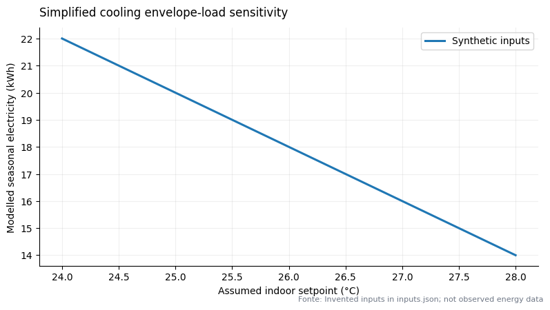

# A higher setpoint lowers the simplified cooling-envelope load

Under the invented assumptions in [`inputs.json`](inputs.json), the deterministic model returns **22 kWh** at a 24°C indoor setpoint, **18 kWh** at 26°C and **14 kWh** at 28°C over a hypothetical ten-day period. At the assumed €0.25/kWh tariff, the corresponding costs are €5.50, €4.50 and €3.50.

This is a sensitivity illustration, not measured household use, a bill estimate or a savings forecast. It assumes constant 35°C outdoor temperature during operation, 100 W/K envelope conductance, eight hours per day for ten days and fixed SEER 4. Infiltration, solar/internal gains, cycling, weather variation, thermal storage and occupancy are excluded. The monotonic direction follows from the formula `conductance × (outdoor temperature − indoor setpoint) × hours ÷ SEER`.

The cited EU regulation supplies terminology context only; it does not support these synthetic input values. A real report would require source-backed climate, building, equipment and tariff inputs plus human review of model scope.
